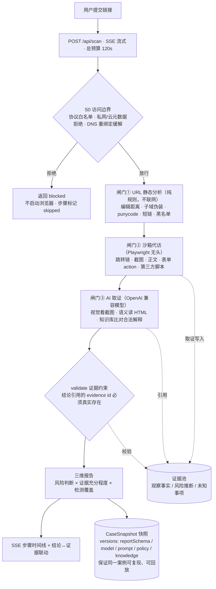

# 网鉴 VeriPage

> 核验网页「声称的身份」与「实际行为」是否一致的 AI 反钓鱼检测台
> 第九届传智杯 AI WEB 网页开发挑战赛 · 参赛作品 · [mostny/veripage](https://github.com/mostny/veripage)

📖 **快速了解项目**：[项目介绍书（简明通俗版）](docs/项目介绍书.md)

本部署分支基于远程 `d00605a`，新增**站内评测登录与 API 鉴权**，并集成已有的**本机案例、案例包导入导出与个人复核**实现；当前云主机状态、测试账号领取方式和边界见 [公网评测部署说明](docs/public-deployment.md)。仅供受邀评测，不开放注册。

**受邀评测入口**：[https://43.136.20.106/login](https://43.136.20.106/login) —— 直接 IP HTTPS，无需域名。登录、访问控制、真实链接检测及文本接口已通过本轮验证；测试边界与待交付材料见 [部署状态](docs/public-deployment.md)。

## 一句话定位

用户发来一个链接，我们替用户「点」进去：把**它声称自己是谁**（标题 / Logo / 话术）与**它实际在做什么**（真实域名 / 跳转链 / 表单提交目标 / 第三方脚本）逐条对照，输出一份**每条结论都绑定证据**的三维核验报告。

## 解决什么问题

| 既有方案 | 解决不好的问题 | VeriPage 的答案 |
|---|---|---|
| 黑名单（PhishTank 等） | 只认识已报案 / 已收录的站，0day 仿冒站天然漏网 | 证据核验不依赖历史报案；黑名单只是闸门①里的一条规则 |
| 直接问聊天 AI | 模型打不开链接、看不到页面，只能凭 URL 字面猜 | Playwright 沙箱代访 + 视觉 / 语义 / 技术三路取证 |
| 传统网页取证工具 | 输出原始数据，不判断「在仿冒谁」，普通人看不懂 | 四问框架 + 证据三级标注 + 可解释报告 |

## 检测线现状（区分主线历史与当前部署分支）

| 检测线 | 现状 | 合入记录 |
|---|---|---|
| 链接检测线（S0 边界 + 三闸门 + 证据约束报告） | ✅ main 已完整可用 | main 主线（含 M1 修复，PR #3） |
| 知识检索线（品牌白名单 / 钓鱼案例 / SSO 合法解释） | ✅ main 已合并：知识证据进编排器 + 有界补证轮 + `versions.knowledge` | PR #7 / #11 |
| 文本体检线（AIGC 识别 + 隐私脱敏） | ✅ main 已合并：`/text` 页 + `/api/text` + 本地正则脱敏；判定带 120s 应用层总时限与取消传播（`app/api/text/route.ts` 的 `composeAigcSignal`） | PR #8 |
| W3 对照实验（三组 + 两组消融 + 61 样本 fixture） | ✅ main 已合并：数据集 / 实验壳 / 报告 | PR #12 |
| 复核治理线（会话隔离截图产物 + 结论 ↔ 证据联动工作台） | ✅ main 已合并：ArtifactStore + 会话隔离端点 + 双向联动工作台 | PR #5 / #6 |
| 部署配置与本文档 | ✅ 随本 PR 合并（Vercel + Docker 双方案已备，未绑定账号） | `yan/deploy-readme` · PR #10 |
| 实验产物隔离（`--tag` / `--dir`）与主分析 `max_tokens` 可配置 | ✅ main 已合并 | PR #13 / #14 |
| 本机案例与个人复核 | ✅ 本部署分支接入：IndexedDB 自动保存、历史回看、个人意见追加、单案例 JSON 包 | 从已有本机实现选择性集成，原工作区保持原状 |

### 本机案例与复核

- 扫描完成后自动保存报告和可用 PNG 到当前浏览器的 IndexedDB；保存失败、截图缺失或敏感副本省略分别告知，可重试或清除。
- `/cases` 支持搜索、按**模型原判**筛选、待复核和更正记录；历史读取本机 Blob，不依赖 15 分钟短期端点，也不重新扫描。
- 个人复核只追加意见，可更正或维持原判；**不覆盖模型原始判断**，不自动进入知识库或原始效果评测。
- 单案例 JSON 包支持导出—删除—导入恢复报告、PNG 与意见；同编号拒绝覆盖，校验失败不写入。格式与隐私边界见 [案例包 v1](docs/case-package-v1.md)。
- 数据仅在当前浏览器／站点保存，不是 reviewer 账号的云历史；换设备不会自动同步，清理站点数据可能丢失记录。截图与复核理由仍可能含敏感内容，分享案例包前需人工核对。

### 链接检测线：一次检测发生了什么（main @ 72240b2）

1. **S0 访问边界**（`lib/guard/access.ts`）：协议白名单；域名先解析再校验 IP，拒绝私网 / 链路本地 / 云元数据地址（防 SSRF 与 DNS 重绑定）。被拒则不启动浏览器，步骤如实标记 `skipped`。
2. **闸门① URL 静态分析**（`lib/tools/url-static.ts`）：纯规则、不联网——域名编辑距离、子域伪装拆穿（`taobao.com.xxx.cn` 的真实可注册主域是 `xxx.cn`）、punycode 同形字符、短链展开预判、黑名单比对、URL 参数 payload 痕迹。
3. **闸门② 沙箱代访**（`lib/tools/fetch-page.ts`）：Playwright 无头浏览器以一次性 context 打开目标页，采集**技术事实**级证据——完整跳转链、整页截图、可见正文、表单 action / method / 是否含密码框、第三方域脚本清单；总预算 20s，任何失败都降级为「取证不完整」而不是抛异常。
4. **闸门③ AI 取证**（`lib/agent/orchestrator.ts`）：视觉模型看截图（在仿冒谁）+ 语义模型读 HTML（话术 / 索要行为）+ 知识库比对（合法解释 / 相似案例引用）；JSON 解析失败自动纠偏重试，两次失败输出 `unknown` 兜底。
5. **validate 证据约束**（`lib/evidence/validate.ts`）：每条结论引用的 evidence id 必须真实存在于证据池——「JSON 可解析」不等于「通过」。
6. **三维报告**：风险判断（high / suspicious / no_significant_risk / unknown）× 证据充分程度 × 检测覆盖（每步 completed / partial / skipped / failed + 原因），经 SSE 实时推送到前端步骤时间线。整次检测总预算 120s（`lib/scans/handler.ts:25` 的 `TOTAL_TIMEOUT_MS`）；文本体检线同等的 120s 应用层总时限在 `app/api/text/route.ts`（`TEXT_TOTAL_TIMEOUT_MS` / `composeAigcSignal`）。

## 快速开始（本地完整版）

环境要求：Node 22.13+（22.x；pnpm 11 的要求，见 `package.json` 的 `engines`）、pnpm 11。

```bash
git clone https://github.com/mostny/veripage.git
cd veripage
git checkout deploy/public-prep-2026-11-14
pnpm install
pnpm exec playwright install chromium
# 国内网络可换镜像：PLAYWRIGHT_DOWNLOAD_HOST=https://npmmirror.com/mirrors/playwright/
pnpm reviewer:create reviewer http://localhost:3000  # 生成 .env 与私密账号文件，已有文件不会覆盖
# 在 .env 配置已授权的模型端点、Key 和模型名；也可使用限定项目的运行时注入
pnpm dev               # http://localhost:3000
```

### 模型端点与环境变量

当前部署使用 **DeepSeek**（`https://api.deepseek.com`，文本与视觉均为 `deepseek-flash`），显式配置非思考模式以配合 120 秒总预算；已通过真实文本 JSON 和中文截图识别冒烟。环境变量保留历史命名 `VERIPAGE_AGNES_*`，不表示当前供应商仍为 Agnes。更换兼容端点前需核对其视觉能力、请求参数、模型权益和计费，不自动切换供应商：

| 变量 | 说明 |
|---|---|
| `VERIPAGE_AGNES_BASE_URL` | OpenAI 兼容端点 base（当前 `https://api.deepseek.com`，代码在其后拼 `/chat/completions`） |
| `VERIPAGE_AGNES_API_KEY` | 端点 Key。**只放 .env；任何配置文件 / README / 提交里都不出现真实值** |
| `VERIPAGE_TEXT_MODEL` | 文本 / 主分析模型（当前 `deepseek-flash`） |
| `VERIPAGE_VISION_MODEL` | 视觉模型，需支持 `image_url` 输入（当前 `deepseek-flash`） |
| `VERIPAGE_PRO_MODEL` | 预留的复杂判断模型 |
| `VERIPAGE_ANALYZER_MAX_TOKENS` | 主分析器输出预算，默认 6000（推理模型先产 reasoning，预算太小会截断 JSON）；只接受**有限正整数**，非法值（如 `0.5`/`abc`）回落 6000 并打警告 |
| `VERIPAGE_TEXT_MAX_TOKENS` | 文本体检输出预算，默认 6000 |
| `VERIPAGE_MODEL_THINKING` | 可选 `enabled` / `disabled`；当前为 `disabled`。留空不发送 `thinking` 字段；非法非空值在发请求前失败 |
| `VERIPAGE_BROWSER_NO_SANDBOX` | 取证浏览器沙箱**逃生阀**，默认不设＝保留 Chromium OS 级沙箱。仅个别内核未开 user namespace、沙箱无法初始化的环境才设 `1`；开启即放弃该层隔离，见下文「安全边界」 |

端点切换记录与历史实测见 [docs/model-notes.md](docs/model-notes.md)。

### 测试套件

```bash
# 不花模型额度的冒烟（Node 24 原生运行 TS；access-guard / fetch-page 需联网，fetch-page 还需本地 chromium）
for f in access-guard url-static evidence knowledge fetch-page m1-regressions scan-sse prompts; do
  node eval/$f.smoke.ts
done
# 真实端点冒烟（会消耗 Key 额度，需先有 .env）
node --env-file=.env eval/orchestrator.smoke.ts
node --env-file=.env eval/models.smoke.ts
```

类型检查 / lint / 生产构建：

```bash
pnpm exec next typegen && pnpm exec tsc --noEmit && pnpm exec eslint .
rm -rf .next && pnpm build
```

## 部署（两套配置已备好，不绑定任何账号）

本分支已启用受邀评测登录；两种方案都需要配置 `VERIPAGE_REVIEWER_USERNAME`、`VERIPAGE_REVIEWER_PASSWORD_HASH`、`VERIPAGE_SESSION_SECRET`、`VERIPAGE_PUBLIC_ORIGIN`，详见 [公网评测部署说明](docs/public-deployment.md)。缺少身份配置时接口返回 503，不降级为匿名访问。

### 方案 A：Docker 自托管（完整版，演示首选）

```bash
node --experimental-strip-types scripts/create-reviewer.mjs  # 首次生成 .env 与私密账号文件
# 在 .env 配置模型，以及最终 HTTPS 地址对应的 VERIPAGE_PUBLIC_ORIGIN（支持公网 IP）
docker compose up -d --build  # 仅本机 http://127.0.0.1:3080/login，公网需 HTTPS 反向代理
```

`Dockerfile` 已装齐 Playwright chromium 的系统依赖与 Noto CJK 中文字体（服务端取证截图需要中文字形，审计 F17），浏览器二进制固定在 `PLAYWRIGHT_BROWSERS_PATH=/ms-playwright`，容器启动不联网下载；容器以专用非 root 用户 `veripage`（uid/gid=10001）运行并叠加 `no-new-privileges:true`（审计 F03）；三闸门全链路可用，行为与本地开发一致。代价：需要一台常驻机器（小型 VPS 即可）。

### 方案 B：Vercel（最快上线）

导入仓库即可构建，**但仅导入仓库不会获得真实模型能力**——部署后必须在项目 Settings → Environment Variables 配置 `VERIPAGE_AGNES_BASE_URL` / `VERIPAGE_AGNES_API_KEY`（按需再加 `VERIPAGE_TEXT_MODEL` / `VERIPAGE_VISION_MODEL` / `VERIPAGE_ANALYZER_MAX_TOKENS`，完整清单见 `.env.example`），否则闸门③的模型调用会明确失败（coverage 如实显示失败步骤，不返回假装完整的报告）。`vercel.json` 已配置：

- `regions: ["hkg1"]` —— 距国内评委最近的区域，且可正常访问模型端点（若套餐不支持自定义函数区域，Vercel 会忽略该字段用默认区域，不影响功能、只影响延迟）；
- `functions["app/api/scan/route.ts"].maxDuration = 120` —— 与 SSE 总预算一致（`lib/scans/handler.ts:25` 的 `TOTAL_TIMEOUT_MS`）；
- Node 版本经 `package.json` 的 `engines.node` 固定为 22.x（Vercel 的 `vercel.json` schema 已不支持 `nodeVersion` 字段，2026-10-30 核对 openapi.vercel.sh/vercel.json）。

**取舍（如实说明）**：Vercel 函数是 serverless 环境，闸门②的 Playwright **没有开箱支持**——要么引入 `@sparticuz/chromium` 一类 Lambda 浏览器方案（需要改 `lib/tools/fetch-page.ts` 的引入方式，本仓库未做此适配），要么接受闸门②降级：扫描以「取证不完整」如实收尾（coverage 维度可见），不会给出假装完整的报告。另外各套餐对函数时长有上限，若低于 120s，平台会在上限处切断连接，前端显示「检测未完成」而不是假结果。**要完整链路演示，请用方案 A。**

### 安全边界（如实分层，审计 2026-10-30 F03）

对「真实不可信公网目标」的执行隔离，当前状态如实分层如下：

**已建立：**

- 容器以专用非 root 用户（`veripage`，uid/gid=10001）运行，`docker-compose.yml` 叠加 `security_opt: no-new-privileges:true`（进程内不得经 setuid/setcap 提权）；
- Chromium 取证浏览器**默认保留 OS 级沙箱**（`lib/tools/fetch-page.ts` 显式 `chromiumSandbox: true`，不再无条件 `--no-sandbox`；仅 `VERIPAGE_BROWSER_NO_SANDBOX=1` 显式逃生阀可关，供个别内核未开 user namespace 的环境使用，开启即放弃该层隔离）；
- S0 目标准入校验：私网 / 链路本地 / 云元数据地址拒绝，浏览器内所有子资源同样过 S0（DNS 重绑定缓解，解析结果缓存 60s）。

**未建立（对公网开放的前置条件，本轮未做、不做虚报）：**

- 采集进程与模型凭据的完全分离——取证浏览器目前仍由持有模型配置的服务进程直接启动；
- 连接级 DNS / 网络出口隔离——Node 侧 DNS 检查放行后由 Chromium 自行发起连接，60s 解析缓存不等于固定实际连接 IP（生产建议独立网络出口/出口代理，并用实际连接记录验收）；
- 弹窗 / 下载 / Service Worker 的全量拦截。

结论：当前部署适合受控 fixture 演示与内部试用；在上述「未建立」项补齐并经验收之前，**不对外提供「隔离取证」性质的公开检测服务**，也不以该词作安全保证。

## 架构（Mermaid）



**证据模型（原创实现重点）**：每条结论三级标注——`observed_fact`（观察事实）/ `inference`（风险推断，标明推理链）/ `reference`（外部引用），全部带 `evidenceIds`，并由 `lib/evidence/validate.ts` 程序化校验引用真实性。快照含 `versions` 版本谱系（reportSchema / model / prompt / policy / knowledge），保证实验可复现与证据回放；人工复核只追加 `ReviewEvent`，**不回填、不改写机器原始判断**。

## 实验数据

W3 三组对照 + 两组消融（A 黑名单+规则 vs B 裸多模态模型 vs C 完整 orchestrator；消融：去视觉 / 去知识库；61 个本地 fixture 样本，不访问外部真实站点）：

- [W3 三组对照实验报告](eval/experiments/results/report.md) —— **2026-10-30 历史模型版本**（PR #12），不是当前 DeepSeek 版复测。历史数字：恶意检出 A 30.3% / B 63.6% / **C 87.9%**，良性误报 A 17.4% / B 39.1% / **C 0%**，结构引用率 **100%（366/366，程序校验引用存在）**；黑名单未命中样本上 A 仅 14.8% vs C 85.2%。结构引用率不等于语义支持率或当前版本检出率。
- 复现命令（走真实模型端点，消耗 Key 额度，全量五组墙钟合计约 143 分钟，见报告第 7 节）：
  - 全量（写 `results/` 正式目录，目标产物已存在时需显式 `--overwrite`）：`node eval/experiments/run-all.mjs --max-tokens 6000`
  - 试跑（必须加 `--tag`，产物落 `results/<tag>/`，不碰 `results/` 下已提交的全量产物）：`node eval/experiments/run-all.mjs --limit 6 --tag trial-xxx --max-tokens 6000`
  - 单组重跑（例）：`node --env-file=.env eval/experiments/run-group.mjs --group C --max-tokens 6000`
  - 预算口径：正式五组统一 `--max-tokens 6000`（A 组不调模型，参数对其无效）。**不带该参数时 B 组默认 2000、C 组走编排器默认 6000，复现不了原统一条件**——历史事实与当前默认的区分见报告 0.5 节（审计 F14）。

## 团队与 Git 历史

- **mostny（hhj）**：main 主检出链路全量实现——Next 16 脚手架、S0 访问边界、闸门①②③、模型适配层、证据契约与校验器、编排器 + SSE、前端两页、PSL 主域解析升级、知识库数据层；以及 P1 知识接线 / P2 文本线 / P3 实验 / 部署与文档等分支任务。
- **Fukaki-Ato（fukaki）**：M1 证据与检测生命周期修复（已合并，PR #3）、改进计划与实测基线文档（已合并，PR #1）、M2 会话隔离临时截图产物（PR #5 审核中）、M3 双向联动证据工作台（PR #6 审核中）。
- 全程细粒度 conventional commits（feat / fix / test / docs / chore / refactor），所有合入走 PR + review；两位提交者的本地 git 身份分别为 `hhj <hhj@veripage.local>` 与 `root <root@localhost.localdomain>`（GitHub 账号即上表两人）。

## 已知边界与诚实声明

- **未提交表单 ≠ 凭据已外传**：表单 action 是观察事实，「可能在索取凭据」是推断，两者分开标注。
- **未收录 ≠ 未授权**：白名单 / 案例库未命中只说明资料未覆盖，不得据此判恶意。
- **取证失败如实输出**：访问失败 / 模型失败 / 本地保存失败分别显示；coverage 维度标 `completed / partial / skipped / failed` + 原因；证据不足时输出 `unknown` 与缺口清单，不硬猜。
- **未检出 ≠ 安全**：存储型 / DOM 型 XSS 等运行时行为超出定位，不可靠检出，报告页脚常驻该声明。
- **AIGC 检测本身不确定**：文本线的 AIGC 判定是概率性提示，不构成法律或事实认定。
- **页面内容一律视为不可信数据**：抗提示注入加固 + 自建可控靶场样本验证；演示样本全部本地可控并标注「演示用」。
- **本地复核 ≠ RAG 入库**：误报更正不自动进入检索知识库、不触发任何模型更新；评测只计算机器原始输出。

## 目录结构

```
app/          页面与 API Routes（/api/scan 为 SSE 流式检测接口）
lib/          agent 编排 / tools（url-static · fetch-page · kb-lookup · rag-search）/ evidence 证据模型 / prompts
knowledge/    钓鱼案例库 + 官方域名与 SSO 白名单（JSON 带来源与版本）
eval/         冒烟测试 + W3 对照实验
docs/         大题框架 / 模型端点实测 / 技术文档
```

详细设计见 [docs/framework.md](docs/framework.md)。

## 团队

| 成员 | 职责 |
| --- | --- |
| 古邑豪 | 检测编排与取证管线（S0 访问准入、Playwright 采集、Agentic 补证编排）；Docker / Vercel 部署与安全加固 |
| 毕瑞奇 | 前端与交互——证据工作台、结论 ↔ 证据双向联动、实时进度流；文本体检线（脱敏 + AIGC 特征提示） |
| 韩鸿杰 | 提示词工程与知识库建设；61 样本 × 5 组对照实验与消融分析；测试体系与质量保障 |

> 开发过程大量使用 AI 结对编程辅助（需求拆解、代码评审、自动化测试与独立审计闭环），仓库保留完整的真实开发与修复历史。
